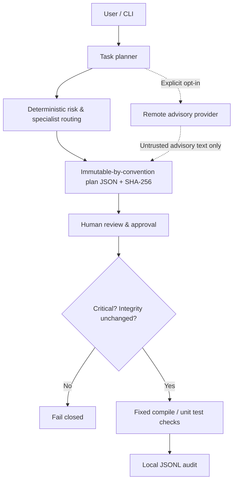

# Architecture — v0.2.0

## Data flow



## Package modules

| Module | Responsibility |
|---|---|
| `cli.py` | Parser, command lifecycle and JSON display |
| `core.py` | Workspace path hygiene, JSON storage, file snapshotting, audit |
| `planning.py` | Rule-based risk and role suggestions, plan fingerprinting |
| `providers.py` | Offline, native OpenAI Responses, Anthropic Messages and compatible non-executable advice |
| `execution.py` | Config validation, approval and strict fixed check commands |
| `scanning.py` | Credential pattern heuristics without disclosing matched values |

## Storage

All generated files live in a project-local `.safeops/` directory, which should be ignored by Git:

```
.safeops/
  config.json
  plans/<12hex>.json
  approvals/<12hex>.json
  audit.jsonl
  run.lock  # only while checks run, absent otherwise
```

`plan.fingerprint` hashes all plan fields except the fingerprint itself. Approvals bind fingerprint, source-tree digest, and `config.json` digest. File snapshots are content hashes over regular files below the workspace root, excluding known generated directories and symlinks, with limits of 5,000 files and 12 MB per file. Limits make incomplete snapshots fail rather than silently sampling large trees.

## Execution model

- The offline planner gives **advice**, not edits.
- The optional HTTP adapters send only supplied task text; native endpoints are pinned, and AI output is always untrusted advice.
- Allowed checks are hard-coded as Python `compileall` and `unittest` modules.
- The tool passes subprocess arguments directly, not through a shell.
- **Test code itself is executable and NOT sandboxed.**
- Critical plans cannot be approved or run.
- Any source-tree or approval-policy change invalidates an existing approval.

## Design tradeoffs

The project favors transparency, low runtime dependencies and deterministic gates over autonomy in v0.1. More capable provider and patch orchestration must wait for a reviewed trust-boundary design. See [ADR 0001](adr/0001-approval-first.md).
