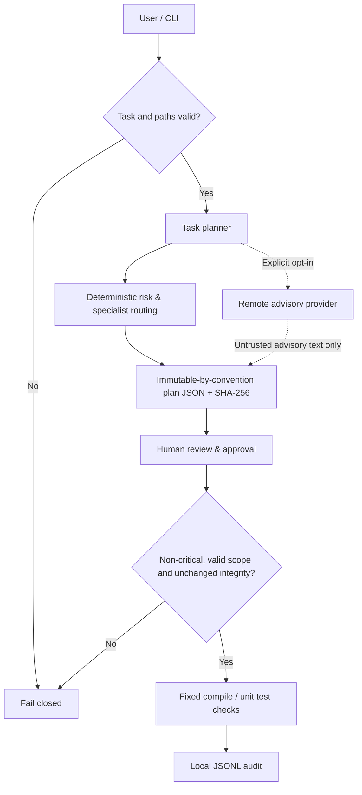

# Architecture — 0.3.0a3

<!-- safeops-version: 0.3.0a3 -->

## Data flow



## Package modules

| Module | Responsibility |
|---|---|
| `cli.py` | Parser, command lifecycle and JSON display |
| `core.py` | Workspace path hygiene, shared strict UTF-8 JSON decoder, storage, file snapshotting, audit |
| `scope.py` | Portable advisory path syntax, link/reparse checks and lifecycle preflight |
| `planning.py` | Rule-based risk and role suggestions, plan fingerprinting |
| `providers.py` | Offline, native OpenAI Responses, Anthropic Messages and compatible non-executable advice |
| `execution.py` | Config validation, approval and strict fixed check commands |
| `check_runner.py` | Child-process unittest discovery, execution and rejection of empty/all-skipped results |
| `scanning.py` | Credential pattern heuristics without disclosing matched values |

## Storage

All generated files live in a project-local `.safeops/` directory, which should be ignored by Git:

```
.safeops/
  config.json
  plans/<12hex>.json
  approvals/<12hex>.json
  audit.jsonl
  run.lock  # only while checks run, absent otherwise
```

Plans and configuration retain schema 1. Approval schema 2 binds the plan fingerprint, source-tree digest, validated configuration digest and execution contract. The contract hashes the installed package version, runner protocol version, fixed command table and UTF-8 stream policy. Legacy approvals remain stored but cannot execute; new review, planning and approval are required.

`plan.fingerprint` hashes all plan fields except the fingerprint itself. File snapshots are content hashes over regular files below the workspace root, excluding known generated directories and symlinks, with limits of 5,000 files and 12 MB per file. Limits make incomplete snapshots fail rather than silently sampling large trees.

## Execution model

- The offline planner gives **advice**, not edits.
- [Scope preflight](SCOPE.md) precedes remote advice/persistence and runs again at approval/run. Declared paths remain advisory; snapshots and fixed check targets are not narrowed.
- The optional HTTP adapters send only supplied task text; native endpoints are pinned, and AI output is always untrusted advice.
- Provider responses share strict UTF-8 object decoding with stored JSON and reject duplicate keys/non-finite numbers. Transport doubles and real loopback fixture requests cover the HTTP path; separate live OpenAI and Anthropic smoke tests have passed, while compatible/local-model and broader account/model validation remain [pending](PROVIDER_TESTING.md).
- Allowed checks are hard-coded as Python `compileall` and the internal `euromind_safeops.check_runner` module, which uses stdlib `unittest`.
- Discovery and `load_tests` hooks run inside that approved child process. Empty discovery, zero executed cases and all-skipped suites fail. Nested regular packages with `__init__.py` are supported.
- The tool passes subprocess arguments directly, not through a shell.
- Fixed Python checks use UTF-8 streams and explicit UTF-8 capture, independent of the inherited locale.
- **Test code itself is executable and NOT sandboxed.**
- Critical plans cannot be approved or run.
- Any source-tree or approval-policy change invalidates an existing approval.

## Design tradeoffs

The project favors transparency, no third-party runtime dependencies and deterministic gates over autonomy. See [ADR 0001](adr/0001-approval-first.md), [ADR 0002](adr/0002-versioned-check-contract.md), [execution policy](EXECUTION.md) and [current status](STATUS.md). Autonomous patch workflows remain planned.
