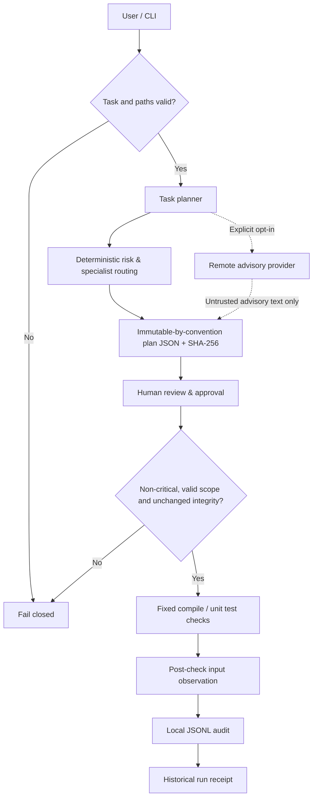

# Architecture — 0.3.0a17

<!-- safeops-version: 0.3.0a17 -->

## Data flow



## Package modules

| Module | Responsibility |
|---|---|
| `application.py` | Current review, exact confirmation, two native guards, write-ahead preparation, per-file revalidation/replacement and conservative rollback |
| `application_journal.py` | Bounded intent/restore/completion records, private backups and read-only double inspection with ownership/conflict fingerprints |
| `cli.py` | Parser, command lifecycle, default display and optional schema-1 JSON envelopes |
| `core.py` | Workspace path hygiene, shared strict UTF-8 JSON decoder, storage, file snapshotting, audit |
| `scope.py` | Portable advisory path syntax, link/reparse checks and lifecycle preflight |
| `preview.py` | Read-only local text replacement validation, exact base hashes and unified diffs; no persisted state or execution authority |
| `staging.py` | Exact-fingerprint confirmation, bounded separate local copy and manifest/receipt; no source application or check execution |
| `stage_review.py` | Bounded current original/plan/base/configuration/target/version/contract review after matching stage; no writes or approval |
| `stage_inspection.py` | Strict historical stage/proposal linkage and bounded double content scan; observations without writes, current-source revalidation or approval |
| `proposals.py` | Local candidate persistence, plan/context bindings and read-only stale/integrity review; no execution authority |
| `planning.py` | Rule-based risk and role suggestions, plan fingerprinting |
| `providers.py` | Offline, native OpenAI Responses, Anthropic Messages and compatible non-executable advice |
| `run_receipts.py` | Bounded safe run contexts, exclusive intent/final metadata, strict historical inspection; no output persistence or approval |
| `supervision.py` | Gated native group/job lifecycle, bounded stream tails, exact completion and confirmed cleanup; retained marker on uncertainty |
| `check_bootstrap.py` | Private fixed-command gate, worker reaping and waiting PID anchor; no approval command |
| `windows_job.py` | Native unnamed job assignment/accounting/termination with noninheritable kill-on-close handle |
| `execution.py` | Config validation, approval and strict fixed check commands |
| `locking.py` | Persistent native guard, owned-marker cleanup, doctor status and explicit archival recovery |
| `check_runner.py` | Child-process unittest discovery, fail-closed execution and aggregate statistics |
| `ci_runner.py` | Maintainer CI adapter appending numeric UTF-8 summaries and optional local JUnit; not a new approved check |
| `junit.py` | Fixed outcome recorder and atomic UTF-8 XML export with synthetic identifiers; no test-supplied report text |
| `target_runner.py` | Recursive directory-target preflight, selected in-memory compilation and selected unittest discovery |
| `scanning.py` | Credential pattern heuristics without disclosing matched values |

## Storage

Workspace state lives in project-local `.safeops/`, which should be ignored by Git.
Maintainer CI summaries/JUnit reports use explicitly selected output paths,
with CI placing XML under `runner.temp`; they are not approval/audit state.
See [reporting](REPORTING.md).

```
.safeops/
  config.json
  plans/<12hex>.json
  approvals/<12hex>.json
  runs/<12hex>/intent.json
  runs/<12hex>/receipt.json
  proposals/<12hex>.json
  stages/<12hex>/intent.json
  stages/<12hex>/receipt.json
  stages/<12hex>/workspace/
  applications/<12hex>/intent.json
  applications/<12hex>/backup-<index>.bin
  applications/<12hex>/new-<index>.bin
  applications/<12hex>/restore-<index>.bin
  applications/<12hex>/restore-<index>.json
  applications/<12hex>/applied.json
  applications/<12hex>/rolled-back.json
  application.pending  # retained ownership marker blocks new runs/applications
  audit.jsonl
  run.guard  # persistent empty native-lock file; never unlink
  run.lock   # owned run marker; retained after abrupt death/initialization failure
  recovered-locks/<id>/receipt.json
  recovered-locks/<id>/run.lock
```

Plans retain schema 1. Configuration defaults to schema 1; optional schema 2 selects [check directories](TARGETS.md). Approval schema 2 binds the plan fingerprint, source-tree digest, validated configuration digest and execution contract. The contract hashes the installed package version, runner protocol version, native-lock protocol, fixed command table and UTF-8 stream policy. Schema-2 config additionally binds all selected regular files in `targets_digest`, including generated descendants. Legacy approvals remain stored but cannot execute; new review, planning and approval are required.

`plan.fingerprint` hashes all plan fields except the fingerprint itself. File snapshots are content hashes over regular files below the workspace root, excluding known generated directories and symlinks, with limits of 5,000 files and 12 MB per file. Limits make incomplete snapshots fail rather than silently sampling large trees.

## Execution model

- The offline planner gives **advice**, not edits.
- [Scope preflight](SCOPE.md) precedes remote advice/persistence and runs again at approval/run. Declared paths remain advisory; snapshots and fixed check targets are not narrowed.
- The optional HTTP adapters send only supplied task text; native endpoints are pinned, and AI output is always untrusted advice.
- Provider responses share strict UTF-8 object decoding with stored JSON and reject duplicate keys/non-finite numbers. Transport doubles and real loopback fixture requests cover the HTTP path; separate live OpenAI and Anthropic smoke tests have passed, while compatible/local-model and broader account/model validation remain [pending](PROVIDER_TESTING.md).
- Schema-1 checks are hard-coded as Python `compileall` and `euromind_safeops.check_runner` (stdlib unittest). Schema 2 uses the fixed `target_runner` adapter: recursive metadata preflight, in-memory Python compilation and one selected unittest root. The child repeats validation; target selection is not access isolation.
- Discovery and `load_tests` hooks run inside that approved child process. Empty discovery, zero executed cases and all-skipped suites fail. Nested regular packages with `__init__.py` are supported.
- The tool passes subprocess arguments directly, not through a shell.
- Fixed Python checks use UTF-8 streams and explicit UTF-8 capture, independent of the inherited locale.
- **Test code itself is executable and NOT sandboxed.**
- Critical plans cannot be approved or run.
- Any source-tree or approval-policy change invalidates an existing approval.

[Optional JSON output](OUTPUT.md) is a presentation layer around command results,
controlled errors and warnings. The CI adapter reuses the same unittest function
and writes only aggregate counts to the job summary. Existing logs remain trusted
code output; no new command authority, provider protocol or isolation is added.

[Native local locking](LOCKING.md) holds a noninheritable guard descriptor across
approval/snapshot validation and checks. Owned-marker cleanup happens before a
successful run audit. Diagnostics do not infer child liveness; recovery archives
retained markers only after explicit fingerprint/acknowledgement/reason checks.
It never runs checks or changes plan/approval history.

## Design tradeoffs

The project favors transparency, no third-party runtime dependencies and deterministic gates over autonomy. See [ADR 0001](adr/0001-approval-first.md), [ADR 0002](adr/0002-versioned-check-contract.md), [execution policy](EXECUTION.md) and [current status](STATUS.md). Autonomous patch workflows remain planned.

[Candidate preview](PREVIEW.md) is a separate read-only path from local JSON to validated diffs. It does not enter the plan/approval/run data flow, call providers or write audit/workspace files.

[Local proposals](PROPOSALS.md) extend candidate inspection with a stored copy and plan/workspace/configuration/selected-target/contract bindings. Creation writes only the proposal and a content-free audit event. Review recomputes context and diffs without writes. Proposals alone grant neither application nor check approval; [application](APPLICATION.md) consumes a matching staged run and a separate exact confirmation.

[Staging](STAGING.md) extends review with an exact-fingerprint-confirmed copy under `.safeops/stages`. Replacements affect independent copied files only. The original snapshot is revalidated; incomplete state is retained. Checks on a staged project need their own init/plan/review/approval cycle. This is not a Git worktree or OS isolation boundary.

`inspect-stage` separately reads retained evidence and compares the filtered staged
copy with its historical manifest. It does not call current proposal review or
load current configuration to establish equivalence with the original. Historical
observations never create an edge to application or execution approval.

`stage_review.py` implements `review-stage`: reuse strict historical inspection, require matching copy, observe current original/context twice, reread safe bounded controls and require unchanged final inspection. It reuses decoded configuration validation without reopening an unsafe policy file. Original snapshot scope differs from filtered staging scope; selected targets retain their own digest/budgets. Result booleans and fixed reasons contain no file text and grant no execution/application authority. See [contract](STAGE_REVIEW.md).

Runner protocol 5 binds receipt schema 1 and disabled import bytecode. Execution lazily imports receipt helpers to avoid module initialization cycles; helpers reuse bounded stage-review snapshots/selected reads and strict native-lock file opens. The guard covers initial observation, intent and post-check revalidation. Terminal receipt follows successful marker cleanup/guard release and audit; inspection remains historical and independent of current control files. See [full result contract](RUN_RECEIPTS.md).

Source 0.3.0a15 adds [explicit reviewed application and conservative rollback](APPLICATION.md). Both staged fixed checks must pass with unchanged current bindings and the same configuration as the original; exact fresh human confirmation and native guards precede private backup/journal preparation and source writes. Any retained application marker blocks new approved runs/applications. Read-only inspection and separately confirmed rollback preserve evidence and refuse observed human edits. No multi-file transaction, power-loss guarantee, Git operation, provider request or OS isolation is added. That milestone used runner 4/lock 2. Fresh version-bound execution approval is required.

Source 0.3.0a16 adds [owned fixed-check supervision](SUPERVISION.md): a gated launcher, POSIX group/PID anchor or Windows kill-on-close job, native completion/termination checks and continuously drained bounded stream tails. Timeout includes ordinary owned descendants and pipe retention; uncertain cleanup retains run.lock and incomplete intent without a final receipt. Runner 5/lock 3 require fresh version-bound approval. This covers cooperating same-group POSIX descendants/job members, not deliberate group/session escapes, hostile-code isolation or automatic stale recovery. The guide defines normal, timeout, cancellation and abrupt-parent-death limits.
