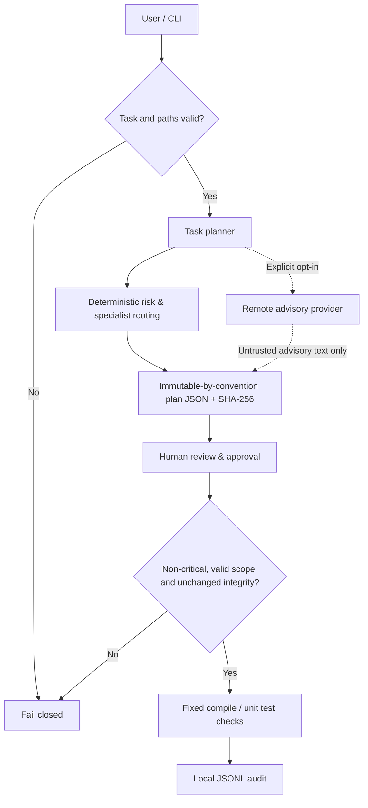

# Architecture — 0.3.0a6

<!-- safeops-version: 0.3.0a6 -->

## Data flow



## Package modules

| Module | Responsibility |
|---|---|
| `cli.py` | Parser, command lifecycle, default display and optional schema-1 JSON envelopes |
| `core.py` | Workspace path hygiene, shared strict UTF-8 JSON decoder, storage, file snapshotting, audit |
| `scope.py` | Portable advisory path syntax, link/reparse checks and lifecycle preflight |
| `planning.py` | Rule-based risk and role suggestions, plan fingerprinting |
| `providers.py` | Offline, native OpenAI Responses, Anthropic Messages and compatible non-executable advice |
| `execution.py` | Config validation, approval and strict fixed check commands |
| `locking.py` | Persistent native guard, owned-marker cleanup, doctor status and explicit archival recovery |
| `check_runner.py` | Child-process unittest discovery, fail-closed execution and aggregate statistics |
| `ci_runner.py` | Maintainer CI adapter appending numeric UTF-8 job summaries; not a new approved check |
| `target_runner.py` | Recursive directory-target preflight, selected in-memory compilation and selected unittest discovery |
| `scanning.py` | Credential pattern heuristics without disclosing matched values |

## Storage

All generated files live in a project-local `.safeops/` directory, which should be ignored by Git:

```
.safeops/
  config.json
  plans/<12hex>.json
  approvals/<12hex>.json
  audit.jsonl
  run.guard  # persistent empty native-lock file; never unlink
  run.lock   # owned run marker; retained after abrupt death/initialization failure
  recovered-locks/<id>/receipt.json
  recovered-locks/<id>/run.lock
```

Plans retain schema 1. Configuration defaults to schema 1; optional schema 2 selects [check directories](TARGETS.md). Approval schema 2 binds the plan fingerprint, source-tree digest, validated configuration digest and execution contract. The contract hashes the installed package version, runner protocol version, native-lock protocol, fixed command table and UTF-8 stream policy. Schema-2 config additionally binds all selected regular files in `targets_digest`, including generated descendants. Legacy approvals remain stored but cannot execute; new review, planning and approval are required.

`plan.fingerprint` hashes all plan fields except the fingerprint itself. File snapshots are content hashes over regular files below the workspace root, excluding known generated directories and symlinks, with limits of 5,000 files and 12 MB per file. Limits make incomplete snapshots fail rather than silently sampling large trees.

## Execution model

- The offline planner gives **advice**, not edits.
- [Scope preflight](SCOPE.md) precedes remote advice/persistence and runs again at approval/run. Declared paths remain advisory; snapshots and fixed check targets are not narrowed.
- The optional HTTP adapters send only supplied task text; native endpoints are pinned, and AI output is always untrusted advice.
- Provider responses share strict UTF-8 object decoding with stored JSON and reject duplicate keys/non-finite numbers. Transport doubles and real loopback fixture requests cover the HTTP path; separate live OpenAI and Anthropic smoke tests have passed, while compatible/local-model and broader account/model validation remain [pending](PROVIDER_TESTING.md).
- Schema-1 checks are hard-coded as Python `compileall` and `euromind_safeops.check_runner` (stdlib unittest). Schema 2 uses the fixed `target_runner` adapter: recursive metadata preflight, in-memory Python compilation and one selected unittest root. The child repeats validation; target selection is not access isolation.
- Discovery and `load_tests` hooks run inside that approved child process. Empty discovery, zero executed cases and all-skipped suites fail. Nested regular packages with `__init__.py` are supported.
- The tool passes subprocess arguments directly, not through a shell.
- Fixed Python checks use UTF-8 streams and explicit UTF-8 capture, independent of the inherited locale.
- **Test code itself is executable and NOT sandboxed.**
- Critical plans cannot be approved or run.
- Any source-tree or approval-policy change invalidates an existing approval.

[Optional JSON output](OUTPUT.md) is a presentation layer around command results,
controlled errors and warnings. The CI adapter reuses the same unittest function
and writes only aggregate counts to the job summary. Existing logs remain trusted
code output; no new command authority, provider protocol or isolation is added.

[Native local locking](LOCKING.md) holds a noninheritable guard descriptor across
approval/snapshot validation and checks. Owned-marker cleanup happens before a
successful run audit. Diagnostics do not infer child liveness; recovery archives
retained markers only after explicit fingerprint/acknowledgement/reason checks.
It never runs checks or changes plan/approval history.

## Design tradeoffs

The project favors transparency, no third-party runtime dependencies and deterministic gates over autonomy. See [ADR 0001](adr/0001-approval-first.md), [ADR 0002](adr/0002-versioned-check-contract.md), [execution policy](EXECUTION.md) and [current status](STATUS.md). Autonomous patch workflows remain planned.
